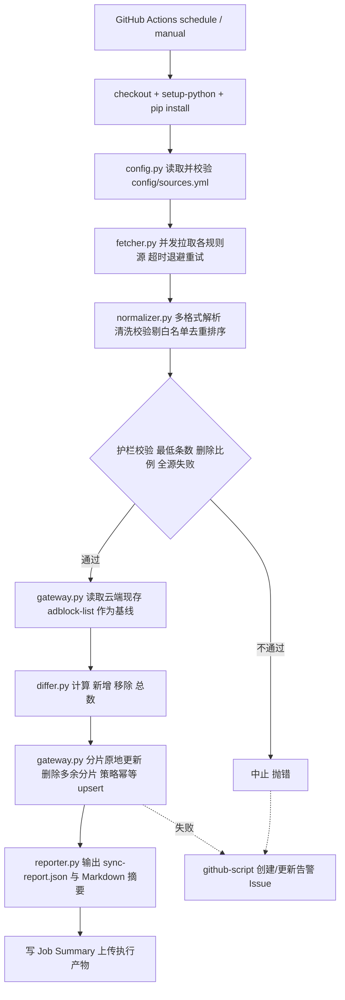

## 产品概述

为 `cloudflare-gateway-adblocking` 仓库增加一套无人值守的每日自动化流水线：由 GitHub Actions 定时触发，从可配置的多个广告拦截规则源拉取最新域名列表，按预定义规则清洗、去重、转换为 Cloudflare Zero Trust Gateway 支持的列表格式，再通过 Cloudflare API 幂等同步到 Gateway DNS 策略，并产出含新增/删除/总数变更量的结构化执行报告与清晰的分阶段日志。

## 核心功能

- **定时与手动调度**：默认每日 UTC 03:17 定时同步（改一行 cron 即可调整频率），同时支持手动触发并可传入试运行、日志级别等参数。
- **多规则源可配置**：新增 `config/sources.yml`，每个源含名称、URL、格式、启停开关，可自由增删；默认预置 StevenBlack hosts、oisd、AdGuard DNS 等 3-4 个主流源。
- **多格式归一化清洗**：支持 hosts、纯域名、AdBlock（`||domain^`）等格式，统一剥离注释/IP/通配前缀、大小写与尾点归一、域名合法性校验、剔除 RFC6761 本地名与白名单、去重后**排序输出**（保证分片稳定可比对）。
- **幂等同步 Gateway**：以云端现存的 `adblock-list-*` 列表为基线，优先原地更新各分片并保持列表 ID 不变（策略全程不中断），必要时才删除重建；列表命名、类型、描述与 `Block Ads` 策略格式严格沿用仓库现有约定。
- **变更统计与执行记录**：对比云端基线计算新增/删除/总数，生成 `sync-report.json` 结构化报告与 Markdown 摘要（含各阶段计数、耗时、失败源明细），并作为执行产物留存归档。
- **凭据安全**：仅通过 GitHub Secrets 注入 `CLOUDFLARE_ACCOUNT_ID` 与 `CLOUDFLARE_TOKEN`，禁止作为命令行参数传入；依赖 GitHub 的自动脱敏。
- **失败告警**：同步失败时自动创建（或复用更新）带指定标签的告警 Issue，含运行链接与失败阶段摘要。
- **可靠性护栏**：请求超时、指数退避重试与并发限流；单源拉取失败不整体失败但记录告警；全源失败、解析结果低于阈值或删除比例超阈值时中止，避免误清空线上策略。

## 预期输出与日志形态

每个阶段输出带 `[config]` `[fetch]` `[normalize]` `[diff]` `[sync]` `[report]` 阶段标签的单行日志，汇总行形如：`[normalize] 汇总 命中白名单剔除=312 重复合并=18403 最终=101247`、`[diff] 基线=101144 本次=101247 新增=+1185 移除=-1082 无变化=99262`、`[sync] 新列表写入 102/102 chunk=1000 并发=5`；同时将结果写入 `sync-report.json`、GitHub Job Summary 与执行产物。

## 技术栈

- **运行环境**：Python >= 3.10（沿用 `pyproject.toml` 现有 `^3.10` 约束），`actions/setup-python@v4`
- **复用现有依赖**：`requests`（同步 API 调用）、`httpx`（异步并发写入）、`loguru`（日志）、`python-dotenv`（可选本地调试）
- **新增依赖**：`pyyaml = "^6.0"`（解析 `config/sources.yml`；Python 3.10 无内置 `tomllib`，故选 YAML 而非 TOML）
- **CI 平台**：GitHub Actions（`schedule` + `workflow_dispatch`），`actions/checkout@v4`、`actions/upload-artifact@v4`、`actions/github-script@v7`（失败告警）
- **不引入**数据库、Docker、额外 SaaS 与第三方 webhook，保持零额外凭据

## 实现方案

### 核心策略与关键决策

1. **幂等性不改变现有 CLI 行为，只在新增编排层实现**。现有 `src/utils/upload.py` 仅用 `POST` 新建列表，每日执行会堆积 `adblock-list-*`，因此不能直接在流水线里复用它。新增 `src/automation/gateway.py` 作为严格客户端，负责列表分片原地更新与策略幂等重建；仓库原有 `upload`/`delete` 子命令保持不动，把改动限制在新增文件，降低回归风险。
2. **同步次序：先读基线 → 再算差分 → 后写入**。云端当前已生效的域名集合是差分基线（自包含，无需维护本地快照分支或跨 Run 产物），必须在任何写操作之前读取完毕，否则 added/removed 无意义。
3. **优先「原地更新 + 稳定列表 ID」而非「先删后建」**。保持列表 ID 不变时，`Block Ads` 策略的 `traffic` 表达式无需改动，策略全程在线不会出现拦截空窗；仅当分片数量增加（需新增列表）时才 `PUT` 更新策略。降级路径：若某分片不支持全量替换，则单独删除并重建该分片，再回读列表集合重建策略。
4. **确定性输出是差分可信的前提**。现有 `utils.convert_to_list` 返回 `list(set(...))`，顺序受 `PYTHONHASHSEED` 随机器影响，跨 Run 不稳定；归一化层改为 sorted 输出，保证分片划分可复现、diff 不被排序抖动污染。
5. **归一化不必改造 `convert_to_list`**。其正则仅识别 `127.0.0.1/0.0.0.0/::1` 前缀的 hosts 行，AdGuard、纯域名格式会被静默丢弃出 0 条。新增 `normalizer.py` 承担多格式解析与清洗，输出统一为 hosts 格式文本落盘后仍可被既有的 `get_blocklists` 消费，做到新能力与原实现并存。

### 数据流程



### 复杂度与性能

- 解析阶段按行流式处理，集合去重，内存占用约 O(唯一域名数)，10 万级域名约数十 MB，时间与行数线性。
- Cloudflare API 调用数约为 `现有分片数 + 新分片数 + 少量策略操作`，默认约 200-300 次/次运行；受 Cloudflare 1200 请求/5 分钟限制约束，写入用 `asyncio.Semaphore(5)` 限并发并对 HTTP 429 遵循 `Retry-After` 退避。避免对单个分片逐域名发请求（N+1）。
- 基线读取（现有分片的 items 枚举）是最大开销来源，采用并发读取 + 分页拉取，整体单次运行预期 3-8 分钟，工作流设 `timeout-minutes: 20` 兜底。

### 关键技术约定（必须沿用，勿自创）

- 凭据环境变量：`CLOUDFLARE_ACCOUNT_ID`、`CLOUDFLARE_TOKEN`
- 网关端点：`https://api.cloudflare.com/client/v4/accounts/{account_id}/gateway/lists`、`.../gateway/lists/{list_id}`、`.../gateway/rules`、`.../gateway/rules/{rule_id}`
- 鉴权头：`Authorization: Bearer {token}` + `Content-Type: application/json`
- 列表：`adblock-list-{i+1}`、`type=DOMAIN`、`description="A blocklist of ad domains"`、`items=[{"value": x}]`；识别前缀 `adblock-list`
- 策略：`name="Block Ads"`、`action="block"`、`enabled=True`、`traffic` 为多片以 `" or "` 连接的 `any(dns.domains[*] in ${list_id})`，单片上限 1000

## 实现要点（执行细节）

- **凭据安全**：所有密钥只通过 `env:` 注入环境变量，禁止出现在命令行参数、URL 或持久文件中；报告里只记录脱敏后的账号 ID 后四位。
- **错误传播**：现有 `delete.py`、`utils.get_lists`、`create_dns_policy` 失败仅 `print` 不抛错，编排层不得依赖它们的返回值判断成败；`gateway.py` 逐次检查 HTTP 状态码与响应 `success` 字段并抛出带上下文的异常，由 `pipeline.py` 统一转成非零退出码。
- **护栏阈值**（在 `sources.yml` 的 `settings` 中配置）：单源解析结果低于 `min_domains_per_source` 视为异常；最终域名数低于 `fail_safe_min_domains` 或删除比例超过 `max_removal_ratio`（默认 0.5）时中止，防止规则源异常导致线上策略被清空；`fail_on_source_error: false` 时允许部分源失败但记入报告。
- **日志**：沿用 loguru 现有格式 `YYYY-MM-DD HH:mm:ss |  LEVEL | message`，额外加阶段标签便于检索；禁止输出令牌、完整响应体（仅保留状态码与 Cloudflare `errors[].message`）；MinIO 式巨量域名明细不入日志，仅写摘要计数与少量样例。
- **GitHub 调度限制**：仓库连续 60 天无活动会自动停用 `schedule`，需在文档中提示；同一仓库建议用 `concurrency.group` 防止手动与定时并发跑。
- **向后兼容**：不修改 `src/utils/` 与 `src/__main__.py` 的任何现有行为；仅在 `pyproject.toml` 追加依赖与第二个入口脚本。

## 目录结构

```
cloudflare-gateway-adblocking/
├── config/
│   └── sources.yml                    # [NEW] 规则源与运行参数总配置。含 settings（分片大小、超时、重试次数、退避系数、护栏阈值、列表前缀、策略名）与 sources 列表（name/url/format/enabled），以及 whitelist 段。默认预置 StevenBlack hosts、oisd、AdGuard DNS 等 3-4 个源并保留可增删注释。
├── src/
│   └── automation/
│       ├── __init__.py                # [NEW] 包标记，暴露 run_sync 便于复用。
│       ├── __main__.py                # [NEW] `python -m src.automation` 入口。解析参数（--config --dry-run --log-level --force --report-path），从环境变量读取凭据并委派 pipeline。
│       ├── config.py                  # [NEW] SourceConfig/WhitelistConfig/Settings 数据类与 load_config()。校验 URL 合法性、format 取值、enabled 过滤、阈值合理性，缺填项错误信息需指向具体字段路径。
│       ├── fetcher.py                 # [NEW] 带超时、指数退避与上限重试的并发抓取；返回原始文本与元信息（字节数、行数、耗时、状态码）。统一 User-Agent，失败返回结构化失败原因而不中断整体。
│       ├── normalizer.py              # [NEW] 多格式（hosts/纯域名/adblock/自动识别）逐行解析：剥离注释、IP 前缀、`||`/`^`、`*.`、引号，小写化与去尾点，域名标签合法性校验，剔除 RFC6761 本地名与白名单，全域去重后排序；统计 raw/valid/dropped 供报告使用。
│       ├── gateway.py                 # [NEW] GatewayClient：读取云端 adblock-list 作为基线（含 items 分页枚举与降级方案）、分片原地全量更新、删除多余分片、创建缺失分片、`Block Ads` 策略幂等 upsert（存在则 PUT 新 traffic，不存在则 POST）。全部操作严格校验响应并对 429 遵循 Retry-After，写入用 Semaphore 限并发。
│       ├── differ.py                  # [NEW] 基于基线与本次集合的差分计算，输出 added/removed/unchanged/total 及变化样例，供报告与日志使用。
│       ├── reporter.py                # [NEW] SyncReport 数据类与序列化：写 sync-report.json（含时间戳、触发方式、提交 SHA、各源明细、差分、写操作计数、耗时、错误信息），并渲染 Markdown 摘要写入 $GITHUB_STEP_SUMMARY。
│       └── pipeline.py                # [NEW] 编排：加载配置→抓取→归一化→护栏校验→读基线→差分→（非 dry-run 时）同步→写报告；负责异常分类、退出码与结论标记。dry-run 下跳过所有写操作但完整输出报告。
├── .github/
│   └── workflows/
│       └── sync-gateway-lists.yml     # [NEW] 主工作流。schedule cron（默认 `17 3 * * *`，注释标明改此处调频率）+ workflow_dispatch（dry_run、log_level、force 输入）；permissions: contents: read, issues: write；concurrency 防并发；timeout-minutes 20；checkout@v4、setup-python@v4 带 pip 缓存、安装依赖后以 env 注入两个 Secrets 运行同步命令；始终步骤上传 sync-report.json 与归一化后的域名文件作为产物；独立 notify 作业在失败时用 actions/github-script@v7 按固定标题检索同名 open Issue，存在则追加评论、不存在则新建并打 `gateway-sync-failure` 标签。
├── docs/
│   └── automation.md                  # [NEW] 自动化专项文档：Secrets 配置表、sources.yml 字段表、workflow_dispatch 输入表、settings 参数表、预期输出说明、逐阶段日志样例、常见失败排查手册。
├── README.md                          # [MODIFY] 新增「每日自动同步」章节：一句话概览、Secrets 设置步骤、调整频率与规则源的做法、指向 docs/automation.md 的链接。
├── pyproject.toml                     # [MODIFY] dependencies 增加 `pyyaml = "^6.0"`；scripts 增加 `cloudflare-gateway-adblocking-sync = "src.automation.__main__:main"`。
└── .gitignore                         # [MODIFY] 追加归一化中间产物目录、`.sync-cache/`、`sync-report.json` 等，避免构建产物误提交。
```

## 关键数据结构

```python
# src/automation/reporter.py —— 流水线唯一对外结构化契约，供 Job Summary、产物与后续审计消费
@dataclass
class SyncReport:
    started_at: str            # ISO8601 UTC
    finished_at: str
    duration_seconds: float
    trigger: str               # schedule | workflow_dispatch
    commit_sha: str
    dry_run: bool
    status: str                # success | failure | aborted
    failure_reason: str | None
    sources: list[dict]        # name/url/format/bytes/lines/parsed/dropped/ok/error
    domains_total: int         # 本次最终生效域名数
    domains_added: int         # 相对云端基线的新增
    domains_removed: int       # 相对云端基线的移除
    domains_unchanged: int
    cloud_before: int          # 同步前云端基线域名数
    lists_created: int         # 新建分片数
    lists_updated: int         # 原地更新分片数
    lists_deleted: int         # 删除的多余分片数
    policy_id: str | None      # Block Ads 策略 ID
    errors: list[dict]         # stage/message/http_status

    def to_json(self, path: str) -> None: ...
    def to_markdown(self) -> str: ...
```

```python
# src/automation/gateway.py —— 同步层对外接口（ hangs-free、严格抛错）
class GatewayClient:
    def __init__(self, account_id: str, token: str, *, timeout: int = 30, max_retries: int = 3, concurrency: int = 5): ...
    def fetch_baseline(self) -> dict[str, set[str]]: ...        # list_name -> domains，写操作前调用
    def upsert_chunks(self, chunks: list[list[str]]) -> Result: ...  # 原地更新/新建/删除多余分片，保持 ID 稳定
    def upsert_policy(self, list_ids: list[str]) -> str: ...    # Block Ads 幂等重建，返回 rule id
```